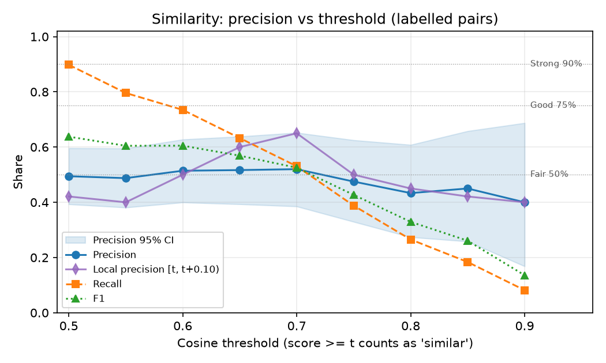

# Similarity thresholds: measured precision

Generated 2026-09-25 by `python -m src.analytics.evaluate_thresholds` from `data/manual/similarity_test_set.csv`: 100 labelled pairs, 49 labelled similar. The labels were generated by an LLM from position and archetype rules (ANALYTICS_DECISIONS.md section 23): a weak but honest baseline, not a human-expert ground truth.

The pairs are stratified by score (one per band per archetype, `build_test_pairs`), so the per-band precision below is the direct reading of a score; the cumulative precision and recall describe this stratified mix, not all pairs in the database. Local precision is over pairs scoring in [t, t + 0.10).

## Precision, recall and F1 by threshold

| Threshold | Pairs >= t | Similar >= t | Precision | 95% CI | Recall | F1 | Local precision (n) |
|---|---|---|---|---|---|---|---|
| 0.50 | 89 | 44 | 49% | 39%-60% | 90% | 64% | 42% (19) |
| 0.55 | 80 | 39 | 49% | 38%-60% | 80% | 60% | 40% (20) |
| 0.60 | 70 | 36 | 51% | 40%-63% | 73% | 61% | 50% (20) |
| 0.65 | 60 | 31 | 52% | 39%-64% | 63% | 57% | 60% (20) |
| 0.70 | 50 | 26 | 52% | 39%-65% | 53% | 53% | 65% (20) |
| 0.75 | 40 | 19 | 48% | 33%-63% | 39% | 43% | 50% (20) |
| 0.80 | 30 | 13 | 43% | 27%-61% | 27% | 33% | 45% (20) |
| 0.85 | 20 | 9 | 45% | 26%-66% | 18% | 26% | 42% (19) |
| 0.90 | 10 | 4 | 40% | 17%-69% | 8% | 14% | 40% (10) |

## Precision within each score band

| Band | Pairs | Similar | Precision | 95% CI |
|---|---|---|---|---|
| <0.45 | 10 | 4 | 40% | 17%-69% |
| 0.45-0.55 | 10 | 6 | 60% | 31%-83% |
| 0.55-0.60 | 10 | 3 | 30% | 11%-60% |
| 0.60-0.65 | 10 | 5 | 50% | 24%-76% |
| 0.65-0.70 | 10 | 5 | 50% | 24%-76% |
| 0.70-0.75 | 10 | 7 | 70% | 40%-89% |
| 0.75-0.80 | 10 | 6 | 60% | 31%-83% |
| 0.80-0.85 | 10 | 4 | 40% | 17%-69% |
| 0.85-0.90 | 10 | 5 | 50% | 24%-76% |
| >=0.90 | 10 | 4 | 40% | 17%-69% |

## Recommended tiers (rule fixed before labelling)

| Tier | Current (judgement) | Measured |
|---|---|---|
| Strong | 85%+ | not supported |
| Good | 70%+ | not supported |
| Fair | 55%+ | 60%+ |
| Weak | below Fair | below Fair |

- Strong: no threshold reaches precision 90% (cumulative and local, >= 10 pairs each); tier not supported by the data
- Good: no threshold reaches precision 75% (cumulative and local, >= 10 pairs each); tier not supported by the data
- Fair: from 0.60, precision 51% (95% CI 40%-63%, n=70); local 50% (n=20); the lowest cut reaching 50% on both
- Weak: below 0.60, 43% of 30 pairs are similar -> keep the Weak tier

Verdict: the measured tiers differ from the current ones.
